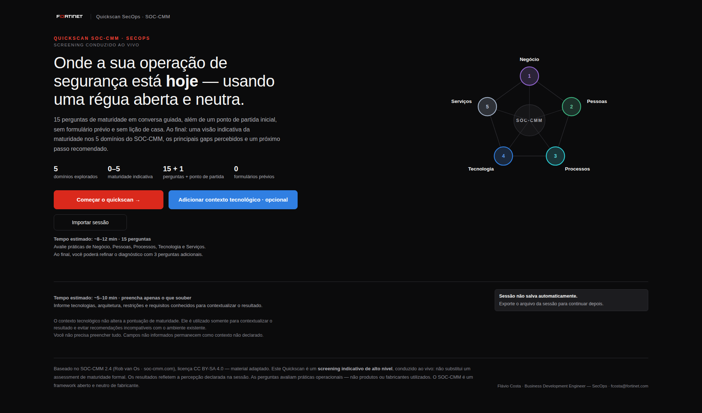

# Quickscan SecOps · SOC-CMM

<a href="https://github.com/oflavioc/quickscan-secops/actions/workflows/verify.yml"></a>

Instrumento de **screening indicativo de alto nível** da maturidade de operações de segurança.
Em 15 perguntas distribuídas por cinco domínios — Negócio, Pessoas, Processos, Tecnologia e
Serviços — produz score de 0 a 5, estágio de maturidade, gaps, cenário-alvo, recomendações
contextuais e um relatório em PDF pronto para leitura executiva.

> **Screening indicativo.** Não substitui assessment formal, auditoria, desenho de arquitetura ou
> proposta comercial. O resultado orienta conversa e priorização — não fundamenta contrato sozinho.



## Estado do produto

| versão | o que é | onde está |
|---|---|---|
| **v3.2.12** | **versão corrente — candidata de selagem, ainda não em produção publicada.** O serviço do proprietário segue na v3.2.11 até o cutover, ato dele. Corrige a **curadoria do relatório** na importação de sessão e em *Nova sessão* (`EA-91`/`EA-92`). Identidade: SHA-256 `024abf113f30098617cf9f0617d51295903634839fb6e1b07b625f13baa03885` (1.248.772 bytes). A tag anotada `v3.2.12` é criada na selagem, sob o nome **proposto** — pendente de ratificação do proprietário. | [registro de selagem](docs_phase5/SELAGEM_V3_2_12.md) |
| v3.2.11 | publicada no ambiente do proprietário em 2026-10-02, **sem tag nem Release do GitHub**, e **superada** pela v3.2.12 antes de ganhar tag: a correção da curadoria mudou o conteúdo, e o nome v3.2.11 já estava ligado a este artefato. Continua servida até o cutover. SHA-256 `4c45ce20fece3bf024dd4a85b99a9766185f48039805ead45d0fe71700bf5712` (1.242.046 bytes). | [registro superado](docs_phase5/SELAGEM_V3_2_11.md) |
| **v3.2.9** | **versão anterior com Release do GitHub**, a última publicada, preservada e verificada como caminho de rollback. | [release `v3.2.9`](https://github.com/oflavioc/quickscan-secops/releases/tag/v3.2.9) |
| v3.2.8 · v3.2.7 · v3.2.6 · v3.2.2 · v3.2.1 | marcos anteriores, com release própria e auditoria externa registrada | [`v3.2.8`](https://github.com/oflavioc/quickscan-secops/releases/tag/v3.2.8) · [`v3.2.7`](https://github.com/oflavioc/quickscan-secops/releases/tag/v3.2.7) · [`v3.2.6`](https://github.com/oflavioc/quickscan-secops/releases/tag/v3.2.6) · [`v3.2.2`](https://github.com/oflavioc/quickscan-secops/releases/tag/v3.2.2) · [`v3.2.1`](https://github.com/oflavioc/quickscan-secops/releases/tag/v3.2.1) |

**A versão corrente do produto é a v3.2.12.** A v3.2.9 permanece preservada e verificada, disponível
para rollback imediato. As versões v3.2.3 a v3.2.5 foram publicadas no ambiente do proprietário sem
release própria; a v3.2.6 consolidou todas, a v3.2.7 acrescentou a **curadoria do relatório** — o
engenheiro escolhe o que de fato será apresentado, e a seção de apoio agrupa por produto em vez de
por gap — a **v3.2.8 corrigiu os cinco defeitos que a primeira sessão real com a curadoria
encontrou** — entre eles o relatório em PDF que saía quase todo em branco e a visão por solução que
desaparecia justamente quando o contexto tecnológico era declarado — e a **v3.2.9 leva a cobertura
do apoio de 4 para 15**: onze gaps que chegavam ao cliente sem dizer por onde começar, entre eles
capacidade do time, capacitação e resposta a incidentes, passam a trazer caminho. O conteúdo não foi
escrito, foi lido da camada congelada da avaliação — o motor é byte a byte o mesmo da v3.2.8.
As **v3.2.10 e v3.2.11** foram publicadas depois no ambiente do proprietário, também sem release do
GitHub; o motor segue o mesmo — `engine_v32.js` tem 0 linhas alteradas desde a selagem da 5.2. A
**v3.2.12 corrige a curadoria do relatório na sessão**: importar uma sessão passa a substituir a curadoria
(e a recusar por inteiro, sem aplicar nada, uma importação inválida), e *Nova sessão* e *Reiniciar avaliação*
passam a limpá-la — antes, a exclusão feita para um cliente podia sobreviver para o seguinte. A v3.2.11 foi
superada antes de ganhar tag; o registro vigente é `docs_phase5/SELAGEM_V3_2_12.md` (o de
`docs_phase5/SELAGEM_V3_2_11.md` fica como trilha). O nome v3.2.12 é proposta pendente de ratificação do
proprietário; a tag anotada é criada na selagem — até lá, a identidade é o SHA-256 da tabela acima.

**Para avaliar ou distribuir a v3.2.12, use o artefato preparado pelo proprietário** (`deploy/`, fora deste
repositório) e confira o SHA-256 `024abf113f30098617cf9f0617d51295903634839fb6e1b07b625f13baa03885` (1.248.772 bytes). Até o
cutover dele, o que está em uso é a v3.2.11 (SHA-256 `4c45ce20fece3bf024dd4a85b99a9766185f48039805ead45d0fe71700bf5712`,
1.242.046 bytes) — não confunda os dois. A v3.2.12 não tem release do GitHub: a última release é a v3.2.9,
que é o caminho de rollback, não a versão corrente. Quando a tag `v3.2.12` existir, ela passa a ser a
referência de código.
Um arquivo `*_dev.html` na árvore de trabalho é candidata, nunca release: antes de avaliar ou
distribuir qualquer HTML, confira a identidade declarada no manifesto da rodada.

Produção, dados de cliente e infraestrutura de publicação **não fazem parte deste repositório**.
Tags, releases e deployment são atos separados da implementação e da auditoria.

## O que o Quickscan é, em linguagem simples

O Quickscan é uma **conversa guiada de cerca de dez minutos** sobre como a segurança é operada hoje.
Quem conduz faz as perguntas ao vivo e registra a resposta que mais se aproxima da realidade
observada. Não há formulário prévio, não há lição de casa e não há certo ou errado.

**O que ele avalia:** práticas operacionais — como o time detecta, investiga, responde, mede e
melhora. Ele não avalia produtos, fabricantes ou arquitetura.

**O que ele entrega:** uma leitura indicativa de maturidade por domínio, os gaps mais evidentes, uma
comparação entre a situação atual e um cenário-alvo declarado, e um próximo passo recomendado.

**O que o contexto tecnológico influencia:** as **recomendações** e a leitura arquitetural. Informar
o que já existe no ambiente evita sugerir o que a organização já tem e ajuda a priorizar.

**O que o contexto tecnológico NÃO influencia:** a **pontuação**. Ele não altera perguntas, respostas,
score, estágio de maturidade, suficiência de evidência nem gaps. Tecnologia, isoladamente, nunca
aumenta a maturidade — possuir uma ferramenta não prova que o processo exista ou seja seguido. Por
isso o contexto tecnológico é sempre **opcional**: uma sessão sem ele produz exatamente a mesma nota.

Perguntas sem resposta confiável devem usar **`Não sei · precisa validar`**. Isso não pontua zero:
entra no resultado como item a validar. `n/d` e zero são coisas diferentes, e a ferramenta mantém a
distinção do começo ao fim.

## Como usar localmente

A aplicação é um **único arquivo HTML autocontido**: sem servidor obrigatório, sem instalação, sem
dependência de runtime.

Obtenha o HTML da v3.2.12 pelo artefato que o proprietário preparou (SHA-256 `024abf113f30098617cf9f0617d51295903634839fb6e1b07b625f13baa03885`,
1.248.772 bytes) — ou, quando for criada na selagem, pela tag `v3.2.12` — e abra no navegador (duplo clique, ou
`Arquivo → Abrir`). A [última release do GitHub](https://github.com/oflavioc/quickscan-secops/releases/latest)
é a v3.2.9, o rollback; não é a versão corrente.
Não há instalação nem servidor.

> O GitHub **não renderiza HTML como página**: clicar no arquivo mostra o código-fonte e o botão
> "Raw" o entrega como texto. Baixe o arquivo e abra localmente.

Quem trabalha no repositório usa a candidata da árvore, que é reconstruída pelo build:

```text
quickscan_secops_soccmm_v3_2_dev.html
```

Servir o diretório por qualquer servidor estático local também funciona. Navegadores baseados em
Chromium são o alvo de referência.

**Nenhum dado sai da máquina.** A ferramenta não faz requisição externa, não usa CDN, fonte remota,
analytics nem telemetria, e não grava nada no armazenamento do navegador. Tudo o que é digitado vive
apenas na aba aberta — e desaparece quando ela fecha.

### Sessão: exportar e importar

Como não há gravação automática, **exportar o JSON da sessão é o que preserva o trabalho**.

- **Exportar:** na tela de resultados, use a ação de exportar sessão. O arquivo `*.session.json`
  contém apenas os *inputs canônicos* — respostas, notas, prioridades e contexto declarado.
- **Importar:** na tela de abertura, use **Importar sessão** e selecione o JSON. Tudo o que é
  derivado (score, estágio, gaps, recomendações) é **recalculado** na importação, nunca lido do
  arquivo. Isso é deliberado: o arquivo guarda o que foi declarado, não o que foi concluído.
- Exportar é o passo **obrigatório antes de trocar de cliente**.

Para reconstruir o HTML a partir das camadas do projeto:

```text
python3 build_v32_html.py
```

O build é determinístico: duas execuções sobre as mesmas fontes produzem o mesmo SHA-256.

## Fluxo resumido

1. inicie uma sessão nova ou **importe** um JSON existente;
2. responda com base em evidência observável, usando `Não sei · precisa validar` quando for o caso;
3. registre evidências e observações por pergunta;
4. declare até três prioridades do negócio;
5. informe o contexto tecnológico — **opcional**: ele não muda a nota, mas muda a recomendação;
6. revise resultados, gaps e cenário-alvo;
7. **exporte a sessão** e gere o relatório/PDF.

## Tela de abertura

Os dois caminhos de entrada ficam lado a lado: **Começar o Quickscan** e **Adicionar Contexto
Tecnológico**, este marcado com o selo `opcional` ao lado. **Importar Sessão** fica logo abaixo, com a
mesma geometria dos demais. O emblema dos cinco domínios é identidade gráfica e traz uma explicação
curta por domínio; ele não representa score nem estágio.

## Contexto tecnológico

O editor de contexto é o mesmo nas duas entradas — pela tela de abertura ou pela seção correspondente
nos resultados — e está organizado em duas regiões: **Capabilities de segurança** e **Ambiente e
condicionantes**. Cada região agrupa famílias que **começam recolhidas**: abra apenas as que
interessam à conversa e o restante permanece fora do caminho. O que você abrir continua aberto
enquanto estiver editando.

Os controles **(i)** existem onde há ambiguidade real de significado: no nome de cada capability, no
cabeçalho de cada família, nos campos de arquitetura, nos subgrupos de requisitos e em cada sinal
declarado. Rótulos que já se explicam sozinhos não carregam controle de ajuda.

Em **Plataformas e licenciamento já existentes** a explicação é única, no cabeçalho do grupo: a seção
registra **base instalada e direitos de uso** — o que está em produção e o que está licenciado ou
contratado. Declarar isso **não prova implantação, cobertura nem maturidade**, e nada nessa seção
altera score, estágio ou gaps.

## Tela de resultados

Em desktop, o resultado é um workspace com trilho de navegação lateral e oito seções na mesma página,
nesta ordem: **visão executiva · prioridades do negócio · domínios e heat map · gaps observados ·
cenário-alvo · contexto tecnológico (opcional) · formas de apoio · relatório e sessão**. A sequência
é narrativa — o quadro geral, o que o negócio pediu, o que foi medido, o que falta e só então para
onde ir e com o quê. Nada fica escondido atrás do trilho: ele é um sumário, não um menu de abas.

Quando a evidência é **insuficiente**, existe uma nona seção: **evidência e suficiência** entra na
**segunda** posição, logo depois da visão executiva, com o painel completo do que falta e o resultado
**bloqueado** — e o cenário-alvo passa a ser o sexto, ainda imediatamente antes do contexto
tecnológico. Quando a evidência é **suficiente**, essa seção não existe: o painel técnico fica dentro
de **relatório e sessão**, atrás do disclosure **“Base de evidência da sessão”**.

O **cenário-alvo** vem imediatamente antes do contexto tecnológico porque é decisão de negócio, não
de produto: ele projeta a comparação Current × Target e **não altera as respostas nem o score
atual**. Os gaps aparecem em dois grupos separados — **altos** e **moderados**. Em telas estreitas,
o trilho vira uma barra de seções e o conteúdo passa a uma coluna.

A aplicação **não salva automaticamente**. Exportar o JSON é o que preserva o trabalho — e é o passo
obrigatório antes de trocar de cliente.

## Documentação

O manual completo de utilização e interpretação está em **[`USER_GUIDE.md`](USER_GUIDE.md)**, e cobre
a semântica das respostas, a diferença entre `n/d` e zero, a influência do contexto tecnológico sobre
o resultado, a leitura do relatório, o cenário-alvo, as recomendações e o checklist pré-entrega.

## Revisão independente

Uma revisão externa deve receber um **pacote fechado e verificável**, não uma cópia informal do
diretório de desenvolvimento. O pacote contém o HTML autocontido da candidata, um README próprio, o
manual, um brief de escopo, as limitações conhecidas, o prompt de auditoria, capturas de referência e
um `MANIFEST_SHA256.txt`.

**Verificação de identidade antes de qualquer análise — nesta ordem:**

1. recalcule o **SHA-256 do próprio ZIP** e compare com o sidecar `.sha256` entregue junto dele;
2. extraia o pacote e execute o **manifesto interno** (`sha256sum -c MANIFEST_SHA256.txt`), exigindo
   `OK` em todas as linhas;
3. confirme que o HTML do pacote é **byte-idêntico** ao HTML da candidata sob revisão;
4. só então comece a análise.

Se qualquer um dos três primeiros passos divergir, o pacote não representa a candidata e a análise
não deve prosseguir. Registre como **não executada** — nunca como aprovada — qualquer verificação que
o ambiente não permita realizar.

Cada rodada gera um pacote novo: assim que qualquer byte do HTML candidato muda, o pacote anterior
fica **superado** e não pode ser apresentado como corrente. Confira sempre a data e o SHA-256 do
pacote que você recebeu.

Não inclua no pacote sessões reais, PDFs de cliente, dados de assessment, credenciais, nem qualquer
configuração de produção, de rede ou de publicação. Pareceres anteriores podem orientar a seleção de
riscos, mas não devem ser tratados como evidência autossuficiente do estado corrente.

## Identidade da versão

A versão do runtime é publicada pela própria aplicação em `window.__QS_BUILD_META.toolVersion` e
aparece no rodapé de metadados do relatório, junto da identidade do engine. Consulte sempre esses
valores — em vez de anotá-los aqui, onde envelheceriam.

## Desenvolvimento

O produto é um HTML único gerado deterministicamente: `build_v32_html.py` injeta os módulos de UI
sobre a Camada 1 congelada (V3.1.3) e o engine V3.2. O desenvolvimento é governado por uma estrutura
de regras, agentes e verificação executável — o índice é o [`CLAUDE.md`](CLAUDE.md) e o resumo para
agentes é o [`AGENTS.md`](AGENTS.md). Mudanças passam por gates com contagens canônicas, identidade
por SHA-256 (`.claude/verify/pins.json`) e um pipeline reproduzido pelo CI Linux a cada push.

```bash
npm ci --no-audit              # node 22/24+
python build_v32_html.py       # build determinístico do HTML
bash .claude/verify/run.sh     # pipeline de verificação (--light para o corte rápido)
```

### Mapa do repositório

| Caminho | O que é |
|---|---|
| `engine_v32.js` · `quickscan_secops_soccmm_v3_1_3.html` | núcleo congelado (engine V3.2 e Camada 1 V3.1.3) — mudança só por rito |
| `ui_*.js` · `ui_*.css` | módulos de UI injetados pelo builder |
| `quickscan_secops_soccmm_v3_2_dev.html` · `ui_icons_v32.js` | artefatos gerados — nunca editados à mão |
| `build_v32_html.py` · `generate_icons_v32.py` | geradores determinísticos |
| `tests_*.js` · `fixtures_*.js` · `tests_visual/` | suítes de verificação com contagens pinadas |
| `specs/` | especificações normativas e de demandas |
| `docs/` · `docs_phase5/` | documentação e registros históricos das fases |
| `.claude/` | estrutura de desenvolvimento: regras, agentes, hooks e pipeline |
| `USER_GUIDE.md` · `SESSION_SCHEMA_V32.md` | manual e contrato de sessão (lidos por suítes — vivem na raiz) |

## Licença

Repositório público para leitura e avaliação. **Todos os direitos reservados** — uso, cópia,
modificação e distribuição dependem de autorização expressa do titular; os termos completos estão
em [`LICENSE`](LICENSE).

## Dados de cliente

Sessões (`*.session.json`), relatórios em PDF e qualquer evidência de assessment **não pertencem a
este repositório**. Guarde-os no repositório de dados do cliente, com o mesmo cuidado dado a qualquer
documento de avaliação. Não registre segredos, credenciais ou dados pessoais desnecessários nos
campos de evidência.
